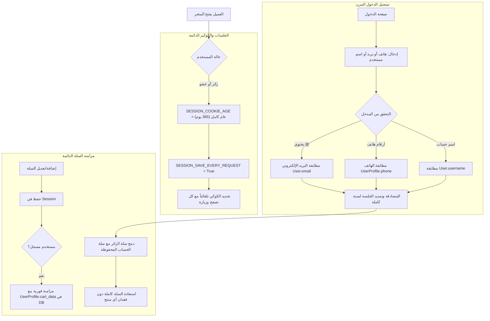

# خطة العمل: تسجيل الدخول المزدوج (هاتف/إيميل)، دوام الجلسات والكوكيز، وربط السلة بحساب العميل

> **المعيار الفني:** Brand Veloura Luxury Standards & Zero Data Loss Architecture.
> **الهدف:** توفير تجربة دخول مرنة وفائقة بالرقم أو الإيميل، منع تسجيل الخروج المفاجئ واليومي عبر كوكيز متجددة طويلة الأمد (عام كامل)، وضمان بقاء عناصر السلة وعدم فقدانها أبداً عند تسجيل الدخول أو التنقل بين الأيام والأجهزة عبر ربطها بحساب العميل في قاعدة البيانات.

---

## 1. التشخيص الدقيق لجذور المشكلات الحالية (Root Cause Analysis)

### أ. تسجيل الدخول كان محصوراً بصرياً برقم الهاتف فقط:
- في قالب `templates/store/auth/login.html`، كان حقل الإدخال يحمل تسمية `رقم الهاتف *` مع `type="tel"` وأيقونة هاتف و `placeholder="770000000"`.
- في الهواتف المحمولة، يُلزم المتصفح بإظهار لوحة أرقام فقط دون أحرف، مما يعيق إدخال البريد الإلكتروني.
- المعرف بحاجة للتعرف التلقائي على الإيميل (`@`)، أو رقم الهاتف بعد تنظيف الرموز، أو اسم المستخدم المباشر.

### ب. سبب تسجيل الخروج اليومي المتكرر (انقطاع الجلسات والكوكيز):
- في دالة `login_view` بملف `store/views.py`:
  ```python
  if remember_me:
      request.session.set_expiry(60 * 60 * 24 * 30)
  else:
      request.session.set_expiry(0)  # ينهي الجلسة فور إغلاق المتصفح أو إنهاء التبويب!
  ```
  وكان مربع الاختيار `remember_me` غير محدد افتراضياً (`unchecked`)! فعندما يغلق العميل المتصفح أو تفرغ ذاكرة الهاتف خلفية التطبيق ليلاً، يُلغي المتصفح الكوكي فوراً، ويصبح المستخدم مسجلاً خروجه في الصباح!
- إعداد `SESSION_SAVE_EVERY_REQUEST` لم يكن مفعلاً (`False` افتراضياً في دجانغو)، وبالتالي لا يُعاد تجديد تاريخ انتهاء الكوكي مع زيارات المستخدم اليومية إلا إذا عدّل في الجلسة.
- قيمة `SESSION_COOKIE_AGE` كانت محصورة في بيئة الإنتاج فقط ومحددة بـ 30 يوماً بدلاً من دورة سنوية دائمة تتجدد تلقائياً.

### ج. سبب اختفاء السلة في اليوم التالي:
- السلة كانت تُحفظ حصراً داخل جلسة المتصفح المؤقتة `request.session['cart']`.
- بمجرد مسح الكوكي أو تسجيل الخروج أو تبديل الجهاز، تُصبح السلة فارغة.
- لا يوجد حقل في نموذج الملف الشخصي `UserProfile` لربط وحفظ عناصر السلة بصورة دائمة في قاعدة البيانات.

---

## 2. الهيكلية المعمارية للحل المقترح (Architecture)



---

## 3. خطة التنفيذ التفصيلية خطوة بخطوة (Action Plan)

### المرحلة 1: ترقية نموذج البيانات وقاعدة البيانات (Database Layer)
- **الملف المستهدف:** `store/models.py`
- **التعديل:**
  إضافة حقل `cart_data` بصيغة `JSONField` إلى نموذج `UserProfile`:
  ```python
  cart_data = models.JSONField(
      default=dict, 
      blank=True, 
      verbose_name='بيانات السلة المحفوظة في الحساب'
  )
  ```
- **الهجرة:** توليد هجرة آمنة وتطبيقها:
  `python manage.py makemigrations store --name userprofile_cart_data`
  `python manage.py migrate`

---

### المرحلة 2: ضبط وتجديد الكوكيز والجلسات عالمياً (Settings & Cookies)
- **الملف المستهدف:** `config/settings.py`
- **التعديل:**
  1. جعل `SESSION_COOKIE_AGE = 86400 * 365` (سنة كاملة = 31,536,000 ثانية) إعداداً شاملاً لجميع البيئات.
  2. تفعيل `SESSION_SAVE_EVERY_REQUEST = True` لتجديد تاريخ انتهاء الكوكي مع كل زيارة أو نقرة يقوم بها العميل تلقائياً (Sliding Expiration).
  3. ضبط `SESSION_EXPIRE_AT_BROWSER_CLOSE = False` لضمان عدم حذف الجلسة عند إغلاق المتصفح نهائياً.

---

### المرحلة 3: بناء خدمات السلة ومزامنة الحساب (Cart Persistence Services)
- **الملف المستهدف:** `store/views.py` و `store/context_processors.py`
- **الدوال الجديدة المضافة:**
  1. `sync_cart_to_profile(request)`:
     عند إضافة أو تعديل أو حذف أي عنصر من السلة عبر الجلسة، إذا كان المستخدم مسجل دخول، تُحفظ السلة فوراً في حقل `request.user.store_profile.cart_data`.
  2. `merge_and_restore_user_cart(request, user)`:
     عند تسجيل الدخول (سواء بالهاتف/الإيميل أو Google):
     - قراءة سلة الزائر الحالية من `request.session['cart']`.
     - قراءة السلة المحفوظة سابقاً في قاعدة البيانات من `profile.cart_data`.
     - دمج السلتين بذكاء دون تكرار (اعتماد الكمية الأنسب للعميل).
     - حفظ السلة المدمجة في الجلسة وفي حساب العميل بقاعدة البيانات.
  3. استعادة السلة التلقائية في `store_context`:
     إذا دخل مستخدم مسجل وكانت سلة جلسته فارغة (مثلاً فتح من متصفح جديد)، يسترجع النظام فوراً سلته المحفوظة من حسابه في قاعدة البيانات ليراها فوراً في الهيدر والبادج.
  4. تفريغ السلة عند تأكيد الطلب فقط في `checkout_view`:
     تفريغ كل من `request.session['cart']` وحقل `profile.cart_data` عند إنشاء الفاتورة وإتمام الطلب بنجاح.

---

### المرحلة 4: تسجيل الدخول المزدوج وتحديث الواجهة (Dual Login & UX)
- **الملفات المستهدفة:**
  - `templates/store/auth/login.html`
  - `store/views.py` (`login_view`)
- **تحديثات الواجهة:**
  1. تغيير التسمية إلى: `رقم الهاتف أو البريد الإلكتروني *`.
  2. تغيير نوع الحقل إلى `type="text"` مع `inputmode="email"` لتمكين إدخال الأرقام والحروف والرموز بسلاسة.
  3. تغيير نص التلميح: `770000000 أو name@example.com`.
  4. تفعيل خيار `تذكر تسجيل الدخول` ليكون مفعلاً ومحدداً افتراضياً (`checked`).
  5. تعديل الفاصل النصي: `أو عبر رقم الهاتف / البريد الإلكتروني والرمز السري`.
- **معالجة السيرفر في `login_view`:**
  1. فحص المدخل:
     - إذا احتوى على `@` -> بحث في `User.objects.filter(email__iexact=identifier)`.
     - إذا طابق اسم مستخدم -> اعتماده مباشرة.
     - إذا كان رقم هاتف -> تنظيف الأرقام والبحث في `UserProfile.phone` أو بالـ 8 أرقام الأخيرة.
  2. ضبط مدة الجلسة:
     - سنة كاملة (365 يوم) إذا كان الخيار مفعلاً (وهو الافتراضي)، و 90 يوماً كحد أدنى بدلاً من إنهاء الجلسة عند إغلاق المتصفح (`set_expiry(0)` التي تم إلغاؤها نهائياً).
  3. استدعاء `merge_and_restore_user_cart(request, user)` فور نجاح تسجيل الدخول.

---

### المرحلة 5: الاختبارات الشاملة وضمان الجودة (Testing & Verification)
- كتابة اختبارات آلية جديدة في ملفات الاختبار لتغطية:
  1. تسجيل الدخول بالبريد الإلكتروني، وبالهاتف وباسم المستخدم.
  2. ثبات الكوكي وتجديد مدتها على كل طلب.
  3. استمرار وحفظ عناصر السلة في `UserProfile.cart_data`.
  4. دمج السلة بعد تسجيل الدخول وعدم فقدان العناصر.
  5. تشغيل مجموعة الاختبارات الكاملة والتأكد من نجاح كافة الاختبارات 100%.

---

## 4. جدول المهام وقائمة التحقق (Checklist)

- [ ] **المهمة 1:** إضافة `cart_data` لـ `UserProfile` وإنشاء وتطبيق الهجرة.
- [ ] **المهمة 2:** ضبط إعدادات الكوكيز والجلسات في `config/settings.py` (`SESSION_SAVE_EVERY_REQUEST` و مدة سنة كاملة).
- [ ] **المهمة 3:** تطبيق دوال مزامنة واستعادة ودمج السلة (`sync_cart_to_profile` و `merge_and_restore_user_cart`).
- [ ] **المهمة 4:** ربط دوال السلة مع `cart_add` و `cart_update_quantity` و `cart_remove_item` و `checkout_view` و `store_context`.
- [ ] **المهمة 5:** ترقية دالة `login_view` لتسجيل الدخول بالرقم أو الإيميل مع تمديد الجلسة لسنة وإلغاء `expiry(0)`.
- [ ] **المهمة 6:** تعديل قالب `login.html` لدعم إدخال الهاتف والإيميل وجعل `remember_me` مفعلاً افتراضياً.
- [ ] **المهمة 7:** كتابة الاختبارات الآلية للتحقق من المزايا الجديدة وتشغيل الفحص الكامل للمشروع.
